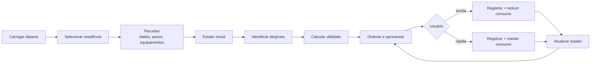

# Agente Inteligente para Recomendação de Economia de Energia

Trabalho 2 da disciplina **UFSM01280 – Agentes Inteligentes para Sistemas Web** (UFSM, 2026/2).

Agente em Python que analisa os equipamentos de uma residência, identifica oportunidades de economia de energia, calcula a **utilidade** de cada alternativa segundo as prioridades dos moradores e recomenda ações em ordem personalizada. O usuário aceita ou rejeita cada recomendação, e o agente atualiza seu **estado** e o **consumo estimado** da residência.

> Entrega: **15/11/2026** · Valor: **4,0 pontos**

---

## Ciclo do agente



## Regras de negócio (resumo do enunciado)

**Elegibilidade** – a oportunidade só pode ser recomendada se, ao mesmo tempo:

| Campo | Condição |
|---|---|
| `reducao_uso` | `True` |
| `economia_potencial_reducao_kwh` | `> 0` |
| `essencialidade` | `!= "essencial"` |
| `impacto_conforto_1a5` | `<= 3` |

**Notas (escala 1 a 5)**

| Critério | Fórmula |
|---|---|
| Economia | `1 + 4 * (economia_potencial / maior_economia_elegivel)` |
| Conforto | `6 - impacto_conforto_1a5` |
| Flexibilidade | `flexibilidade_reducao_uso_1a5` |
| Baixo esforço | `6 - esforco_1a5` |

**Utilidade**

```
utilidade = peso_economia * nota_economia
          + peso_conforto * nota_conforto
          + peso_flexibilidade * nota_flexibilidade
          + peso_baixo_esforco * nota_baixo_esforco
```

## Estrutura do repositório

```
.
├── dados/
│   └── dataset_consumo_energia.csv   # dataset fornecido pelo professor (não alterar)
├── agente_energia.py                 # código-fonte do agente
├── LEIA-ME.txt                       # instruções de execução (entregável)
└── README.md
```

## Como executar

Requisitos: Python 3.10+ (sem bibliotecas externas).

```bash
python agente_energia.py
```

A residência simulada é definida pela constante `RESIDENCIA_SELECIONADA` no início do arquivo. Basta trocar o identificador (`R01` a `R10`) para executar a mesma lógica em outra residência.

## Planejamento

O desenvolvimento está dividido em issues, uma por responsabilidade do agente, agrupadas no milestone **Trabalho 2 – Entrega**. Cada issue contém contexto, tarefas, critérios de aceite e a seção correspondente do enunciado.
