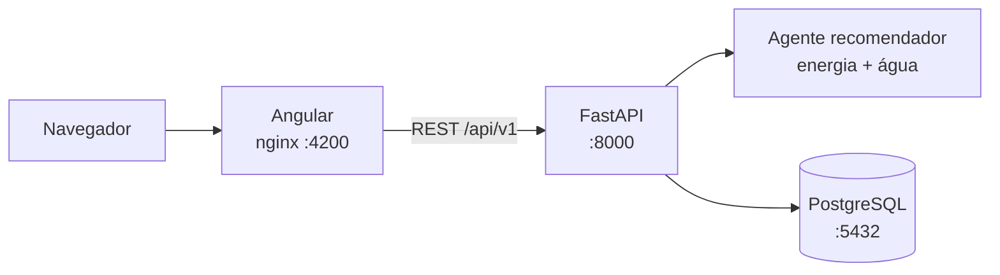
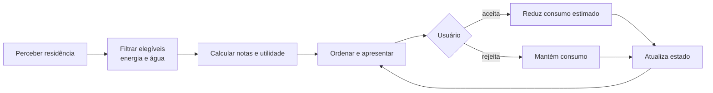

# Agente Recomendador de Energia e Água

Plataforma web com um **agente inteligente** que recomenda ações personalizadas para reduzir o
consumo de **energia elétrica** e de **água** em residências. Nasceu como o Trabalho 2 da disciplina
UFSM01280 – Agentes Inteligentes para Sistemas Web (UFSM, 2026/2) e está evoluindo para um produto completo.

> 🚧 Em desenvolvimento. O planejamento está nas [issues](../../issues) e no [AGENTS.md](AGENTS.md).
> A versão original de terminal continua disponível em `agente_energia.py`.

## Funcionalidades

- Cadastro e login de usuários (JWT), com papéis **admin** e **cliente**
- Cadastro de residências, preferências (pesos) e equipamentos de energia e de água
- Recomendações ordenadas por **utilidade ponderada** às prioridades dos moradores
- Feedback (aceitar/rejeitar) que atualiza o consumo estimado e o histórico
- Painel de administração para gerenciar usuários, equipamentos, categorias e simulações
- API REST documentada (OpenAPI/Swagger)

## Arquitetura



| Camada | Tecnologia |
|---|---|
| Backend | Python 3.12, FastAPI, SQLAlchemy, Alembic |
| Banco | PostgreSQL 16 |
| Frontend | Angular + Angular Material |
| Infra | Docker e docker compose |

Diagramas ER e de classes: [docs/diagramas.md](docs/diagramas.md).

## Ciclo do agente



### Regras

**Elegibilidade**: `reducao_uso = True`, `economia_potencial > 0`, `essencialidade ≠ essencial`, `impacto_conforto ≤ 3`.

| Critério | Nota (1 a 5) |
|---|---|
| Economia | `1 + 4 × (economia / maior economia elegível)` |
| Conforto | `6 − impacto_conforto` |
| Flexibilidade | `flexibilidade_reducao_uso` |
| Baixo esforço | `6 − esforço` |

`utilidade = Σ peso × nota` — energia em kWh/dia, água em litros/dia.

## Como executar (Docker)

```bash
cp .env.example .env
docker compose up --build
```

- Frontend: http://localhost:4200
- API / Swagger: http://localhost:8000/docs

O admin inicial é criado a partir das variáveis `ADMIN_EMAIL` e `ADMIN_SENHA` do `.env`.

## Versão original (terminal)

```bash
python agente_energia.py
```

Requer Python 3.10+, sem dependências. A residência é escolhida pela constante `RESIDENCIA_SELECIONADA` (R01 a R10).

## Contribuindo

Leia o [AGENTS.md](AGENTS.md): stack, estrutura, regras do agente e convenções de branch, commit e PR.
