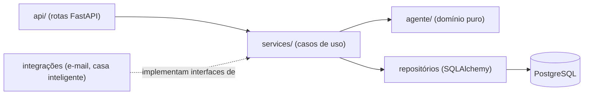

# Padrões de projeto

Usamos os padrões do catálogo do [Refactoring Guru](https://refactoring.guru/pt-br/design-patterns)
**somente onde resolvem um problema concreto**. Cada padrão abaixo diz qual problema resolve e
onde está no código. Se um padrão ainda está planejado, a issue correspondente aparece na tabela.

## Arquitetura em camadas



- O **domínio** (`app/agente/`) não importa nada de banco, HTTP ou entrada/saída e é testado sem infraestrutura.
- As **rotas** são finas: validam entrada, chamam um serviço e devolvem o resultado.
- Dependências são entregues por **injeção de dependência** do FastAPI (`Depends`), nunca por Singleton global.

Decisão registrada em [ADR 0001](adr/0001-arquitetura-em-camadas.md).

## Catálogo

| Padrão | Onde | Problema que resolve | Situação |
|---|---|---|---|
| [Facade](https://refactoring.guru/pt-br/design-patterns/facade) | `app/agente/agente.py` → `AgenteRecomendador` | API e voz usam uma interface simples (`perceber`, `recomendar`, `responder`) sem conhecer estratégias, regras e cálculos | ✅ |
| [Strategy](https://refactoring.guru/pt-br/design-patterns/strategy) | `app/agente/estrategias.py` → `EstrategiaRecurso`, `EstrategiaEnergia` | Energia e água variam sem `if recurso == ...` espalhado | ✅ energia · água na #33 |
| [Template Method](https://refactoring.guru/pt-br/design-patterns/template-method) | `EstrategiaRecurso.recomendar` | O ciclo filtrar → pontuar → ordenar é fixo; só `descricao_acao` varia | ✅ |
| [Factory Method](https://refactoring.guru/pt-br/design-patterns/factory-method) | `FabricaEstrategia.para(recurso)` | Novo recurso entra registrando uma estratégia, sem tocar em quem a usa | ✅ |
| [Chain of Responsibility](https://refactoring.guru/pt-br/design-patterns/chain-of-responsibility) | `app/agente/regras.py` | Cada regra de elegibilidade isolada e testável, com o motivo da reprovação (usado na explicabilidade, #101) | ✅ |
| [Builder](https://refactoring.guru/pt-br/design-patterns/builder) | `tests/agente/construtor.py` | Dados de teste válidos, mudando só o campo que importa | ✅ testes |
| [State](https://refactoring.guru/pt-br/design-patterns/state) | Simulação (ativa/encerrada) e recomendação (pendente/aceita/rejeitada) | Transições inválidas viram erro de domínio | Parcial: `EstadoSimulacao` impede resposta repetida · completo na #34 |
| [Command](https://refactoring.guru/pt-br/design-patterns/command) | Feedback e ações em dispositivos com `executar()`/`desfazer()` | Desfazer (#48), histórico e auditoria (#93) | Planejado: #34, #74 |
| [Observer](https://refactoring.guru/pt-br/design-patterns/observer) | Eventos de domínio (`RecomendacaoAceita`, `MetaAtingida`, `ConsumoAnormal`) | Auditoria, e-mail, alertas e aprendizado sem acoplar ao serviço | Planejado: #93, #74, #100 |
| [Adapter](https://refactoring.guru/pt-br/design-patterns/adapter) | `EnviadorEmail`, `ConectorCasa`, importação de tarifas ANEEL | Serviços externos com a mesma interface interna | Planejado: #89, #67, #98 |
| [Decorator](https://refactoring.guru/pt-br/design-patterns/decorator) | Cache e métricas em repositórios e calculadoras de tarifa | Comportamento extra sem alterar a classe | Planejado: #98, #66 |

Fora do catálogo GoF: **Repository** e **Unit of Work** (acesso ao banco, #26) e **Value Objects**
imutáveis (`Pesos`, `Oportunidade`, `Notas`), que se validam na criação.

## Exemplo: adicionar um novo recurso

```python
class EstrategiaGas(EstrategiaRecurso):
    recurso = Recurso.GAS

    def descricao_acao(self, oportunidade: Oportunidade) -> str:
        return "Tampar as panelas ao cozinhar."

FabricaEstrategia.registrar(EstrategiaGas)
AgenteRecomendador([Recurso.ENERGIA, Recurso.GAS])  # nada mais muda
```

## Anti-padrões que evitamos

- **Singleton** para sessão de banco ou configuração: use `Depends` (testável e substituível).
- **Regra de negócio em rotas ou componentes Angular**: ela vive no domínio ou nos serviços.
- **Modelo anêmico**: os objetos de domínio validam o próprio estado (`Pesos` recusa soma ≠ 1).
- **Obsessão por primitivos**: quantidades e dinheiro são `Decimal`, nunca `float`; escalas e recursos são tipos próprios.

## Refatoração

O template de PR traz o checklist de [code smells](https://refactoring.guru/pt-br/refactoring/smells).
Limites automáticos no ruff: complexidade ciclomática ≤ 10 (`C901`) e as regras de tamanho do Pylint (`PL`).
